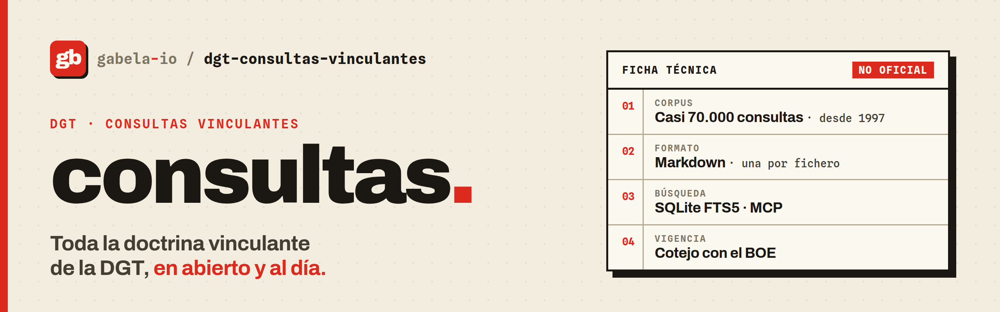

<div align="center">

<picture>
  <source media="(prefers-color-scheme: dark)" srcset=".github/assets/banner-dark.png">
  
</picture>

### Every binding ruling of Spain's tax authority, as open data.

Nearly 70,000 DGT *consultas vinculantes* in Markdown, updated every week.

[](https://github.com/gabela-io/dgt-consultas-vinculantes/actions/workflows/ci.yml)
[](consultas/)
[](consultas/)
[](.github/workflows/update.yml)
[](pyproject.toml)
[](#mcp-server-for-agents)
[](flake.nix)
[](LICENSE)

[Quick start](#quick-start) · [Data format](#data-format) · [Usage](#usage) · [Development](#development)

<code>git clone --depth 1 https://github.com/gabela-io/dgt-consultas-vinculantes</code>

</div>

This repository holds every binding ruling (*consulta vinculante*) that Spain's Dirección General de Tributos (DGT) has published since 1997, one Markdown file per ruling. It also has the scraper that keeps the corpus current, a full-text search index with an MCP server for AI agents, and a check that flags rulings whose quoted law has changed since they were issued.

## About

The DGT publishes its binding rulings only through [PETETE](https://petete.tributos.hacienda.gob.es/consultas/), a web search form. PETETE has no bulk download, no API and no stable links, and it doesn't say whether a ruling still reflects the law. Here the whole corpus is plain text under git, so you can search it, load it into a notebook or hand it to an agent without scraping PETETE yourself.

> [!IMPORTANT]
> This is an **unofficial** project. It is not affiliated with or endorsed by the Ministerio de Hacienda, the Dirección General de Tributos or the Agencia Tributaria.
>
> **Origen de los datos: Ministerio de Hacienda** (Dirección General de Tributos, [PETETE](https://petete.tributos.hacienda.gob.es/consultas/)). Last update: **October 19, 2026**. The texts are reproduced as published; nothing here is legal advice. Check the official `url` of a ruling before citing it, and treat `stale` signals as evidence to review, not as a legal verdict.

## Features

- Over 70,000 entries since 1997, one Markdown file with YAML frontmatter per ruling.
- Search over a SQLite FTS5 index with Spanish stemming, so singular, plural and accents don't matter. Each result comes with a short snippet.
- Lookups by number, by law and article, and by citation: which rulings cite V2583-12, or which apply art. 164 LIVA.
- An MCP server with `search`, `read`, `by_legislation`, `citations`, `stale` and `info`. Agents read a few KB per call instead of whole files.
- A status for every ruling: what the DGT says about it (annulled, replaced by…) and whether someone has reviewed it as current or superseded. The status lives in its own file; the official text is never edited.
- `stale`, which compares the passages a ruling quotes with the BOE consolidated texts and reports amendments, repeals and later rulings that use the new wording.
- Atom feeds of new rulings, one for everything and one per tax office (IRPF, IVA, Sociedades…).
- The scraper, with an adaptive rate limit, checkpoints and a raw HTML cache. A weekly workflow runs it, validates the result and commits.

## Quick start

```bash
# 1. Get the corpus (about 850 MB on disk)
git clone --depth 1 https://github.com/gabela-io/dgt-consultas-vinculantes
cd dgt-consultas-vinculantes

# 2. Enter the dev shell and build the search index (a minute or two)
nix develop
just index

# 3. Search, read, check
just search "criptomonedas staking"
just read V0063-24 -s question -s answer
just stale V0218-23
```

## Installation

### With Nix (recommended)

The dev shell provides Python, uv, `just` and the formatter. With [direnv](https://direnv.net/) it loads automatically (`direnv allow`); otherwise run `nix develop`. The package builds with `nix build .#dgt-consultas`.

### Without Nix

```bash
uv run dgt-consultas --help
```

### Only one year of data

```bash
git clone --depth 1 --filter=blob:none --sparse https://github.com/gabela-io/dgt-consultas-vinculantes
cd dgt-consultas-vinculantes
git sparse-checkout set consultas/2025
```

### Requirements

- Nix with flakes, or uv and Python ≥ 3.11
- About 1.5 GB of disk for the corpus plus the index
- Network access to the BOE open data API for `stale` (responses are cached for a week)

## Data format

The texts are in Spanish, and so are the frontmatter keys and section headings: they are the published format.

```markdown
---
fecha: '2024-02-15'
normativa: Ley 35/2006, Arts.17.1 y 42.3.c)
numero: V0063-24
organo: SG de Impuestos sobre la Renta de las Personas Físicas
url: https://petete.tributos.hacienda.gob.es/consultas/?num_consulta=V0063-24
---

# Consulta Vinculante V0063-24

## Descripcion de hechos

El consultante extinguió su relación laboral con una entidad financiera...

## Cuestion planteada

Aplicación a las primas del seguro de asistencia sanitaria de la exención...

## Contestacion

La letra c) del apartado 3 del artículo 42 de la Ley 35/2006...
```

| Field | Content |
|---|---|
| `numero` | Ruling number (`V0063-24`) |
| `fecha` | Issue date, ISO 8601 |
| `organo` | Issuing subdirectorate (IRPF, VAT, corporate tax…) |
| `normativa` | Cited legislation, as published by PETETE |
| `url` | Link to the ruling on PETETE |

Files live in `consultas/<year>/<number>.md`. The three section headings (facts, question, answer) have no accents and never change, so splitting on `^## ` works. In Python, [`python-frontmatter`](https://pypi.org/project/python-frontmatter/) reads the files.

> [!NOTE]
>
> - About 1,300 entries are DGT notices rather than rulings: `Número de consulta anulado`, `Consulta sin contenido al ser reemplazada por…`, `Consulta contestada que no es objeto de publicación`. The notice is part of the file name and of `numero`, and the search index leaves these entries out.
> - The directory year comes from the number: `V0063-24` lives in `2024/`. One DGT typo breaks this. `V1536-36` was issued in 2026, so it goes by its date; the number is kept as published.
> - Eight rulings from 2002 to 2006 were published without the `V` prefix. `0027-06` and `V0027-06` are different rulings.
> - In 2026 the DGT changed its procedure and left V1690-26 to V4999-26 unused. The newer series starts at V5000-26.

## Usage

| Command | What it does |
|---|---|
| `just search QUERY` | Ranked search with snippets (`--from`, `--to`, `--office`, `--field`, `--match any`) |
| `just read NUMBER` | A ruling's metadata and chosen sections (`-s question -s answer`) |
| `just by-law LAW [ARTICLE]` | Rulings whose `normativa` cites a law and article, newest first |
| `dgt-consultas citations NUMBER` | Rulings this one cites, and rulings citing it |
| `just stale NUMBER…` | JSON report of amendments affecting each ruling; exit 10 if any is possibly stale |
| `just index` | Rebuild the search index (after every corpus update) |
| `just update` / `just fetch YEAR` | Download new rulings from PETETE |
| `dgt-consultas refetch NUMBER…` | Download specific rulings again (e.g. ones that came back empty) |
| `dgt-consultas validate` | Check the corpus for malformed files; fails on issues not in `validation-baseline.json` |
| `dgt-consultas feeds` | Write the Atom feeds to `docs/feeds/` |
| `dgt-consultas status` | Refresh `status/consultas.jsonl` from the DGT notices and `reviews/` |
| `just stats` | Rulings per year |
| `dgt-consultas mcp` | MCP server over stdio |

Run `dgt-consultas <command> --help` for all options.

### Search

```bash
just search "modelo 347 arrendamiento" --from 2022
just search '"inversión del sujeto pasivo"' --field question
just by-law 37/1992 164
```

Each result shows the number, date, office, cited legislation and a snippet of about 300 characters. The search is lexical, so concrete terms that appear in the rulings work better than long questions.

### Status of a ruling

Every ruling carries two statuses plus a list of clarifications, stored in [`status/consultas.jsonl`](status/consultas.jsonl) and shown by `read`, `search` and the MCP server. The Markdown files are never edited.

| Status | Values | Source |
|---|---|---|
| Publication | `published`, `annulled`, `replaced` (with `replaced_by`), `unpublished`, `not_binding`, `empty` | The DGT's own notices on PETETE |
| Currency | `superseded` (with `superseded_by` when there is one), `current`, `unreviewed` | A human review in [`reviews/`](reviews/); the DGT replacing the ruling; or a later ruling where the DGT states it changes this one's criterion |
| Clarifications | `clarified_by`: later rulings that clarify this one, at the requester's or the DGT's initiative | The DGT's own clarification rulings |

`superseded` means a human or the DGT marked at least part of a ruling as outdated. The core criterion often still holds, so read the note to see which part.

When the DGT changes a criterion, the new ruling says so: "Esta conclusión supone un cambio de criterio respecto al mantenido por esta Dirección General… número V0939-11". The earlier rulings are then marked superseded, with the DGT's sentence as the note, because a change often covers only part of a ruling. Clarifications don't supersede anything; they go in `clarified_by`.

`unreviewed` means nobody has checked the ruling yet, so it may or may not be current. Reviews are YAML files, one per ruling, and you can contribute them:

```yaml
# reviews/V0218-23.yaml
number: V0218-23
status: superseded
reviewed: 2026-10-19
by: gabela
superseded_by: V1435-24
note: >-
  The IAE part is superseded: it places writers in group 861 of the IAE
  tariffs, but Ley 31/2022 (art. 70.3, in force since 2023-01-01, before this
  ruling) added group 864 "Escritores y guionistas", which V1435-24 applies.
  The VAT and IRPF parts are unaffected.
```

After adding one, run `dgt-consultas status` to refresh `status/consultas.jsonl`; CI checks that it is up to date.

### Is a ruling still current?

`stale` compares the passages a ruling quotes verbatim with every later version of those provisions in the BOE consolidated texts, from 12 months before the ruling until today:

```bash
just stale V0218-23 V1435-24
uv run dgt-consultas stale V0218-23 --since 2026-09-01   # only changes effective since then
```

Each signal has a severity. Only the first two mark a ruling as `possibly_stale`:

| Severity | Meaning |
|---|---|
| `conclusion` | The change touches very specific terms of the facts or question (e.g. "escritor" and the new IAE group 864 "Escritores y guionistas") |
| `reference_or_amount` | Inside the quoted passage, an amount changed (25 → 40 por ciento) in a passage on the question's topic |
| `text_changed` | The quoted passage was edited, but not on the question's terms (for review) |
| `repealed` | A law the ruling relies on was repealed; a successor usually carries the criterion over (for review) |

Boilerplate such as law titles or "de acuerdo con lo previsto en" doesn't count as a quote, and the BOE's editorial notes are ignored. On a small private benchmark (36 hand-reviewed rulings, only 4 of them superseded), `stale` flagged 2 of the 4 with no false positives; the sample is too small to estimate precision. The two misses depend on form box numbering, which the BOE doesn't publish as text. `scripts/eval_stale.py` measures changes against a benchmark file of your own.

### MCP server for agents

`dgt-consultas mcp` gives agents six tools over the index: `search`, `read`, `by_legislation`, `citations`, `stale` and `info`. The server won't start until you build the index with `just index`. To use it from Claude Code in every project:

```bash
claude mcp add --scope user dgt-consultas -- \
  uv run --quiet --directory "$PWD" dgt-consultas mcp --corpus "$PWD"
```

### Follow new rulings

The weekly update writes Atom feeds to [`docs/feeds/`](docs/feeds/), which GitHub Pages serves. Any feed reader (Feedly, Inoreader, Thunderbird…) can subscribe, and feed-to-email services turn them into alerts:

| Feed | Rulings |
|---|---|
| [`all.xml`](https://gabela-io.github.io/dgt-consultas-vinculantes/feeds/all.xml) | The latest 100, from every office |
| [`irpf.xml`](https://gabela-io.github.io/dgt-consultas-vinculantes/feeds/irpf.xml), [`iva.xml`](https://gabela-io.github.io/dgt-consultas-vinculantes/feeds/iva.xml), [`sociedades.xml`](https://gabela-io.github.io/dgt-consultas-vinculantes/feeds/sociedades.xml) | The latest 50 on personal income tax, VAT and corporate tax |
| [`patrimoniales.xml`](https://gabela-io.github.io/dgt-consultas-vinculantes/feeds/patrimoniales.xml), [`especiales.xml`](https://gabela-io.github.io/dgt-consultas-vinculantes/feeds/especiales.xml), [`internacional.xml`](https://gabela-io.github.io/dgt-consultas-vinculantes/feeds/internacional.xml), [`operaciones-financieras.xml`](https://gabela-io.github.io/dgt-consultas-vinculantes/feeds/operaciones-financieras.xml), [`tributos-locales.xml`](https://gabela-io.github.io/dgt-consultas-vinculantes/feeds/tributos-locales.xml), [`tributos.xml`](https://gabela-io.github.io/dgt-consultas-vinculantes/feeds/tributos.xml) | The latest 50 for each of the other offices |

Each entry links to the ruling on PETETE and in this repository, with the question, the issuing office and the cited legislation.

### Keep the corpus up to date

Every Monday [`update.yml`](.github/workflows/update.yml) fetches new rulings, runs the tests and `dgt-consultas validate`, regenerates the feeds and the "Last update" date above, and commits as `github-actions[bot]`. You can also start it from the Actions tab, or run the same steps locally:

```bash
just ping          # check that PETETE answers
just update        # fetch what's new in the current year
just index         # rebuild the search index
```

The scraper starts at one request per second, speeds up while PETETE answers well and halves its rate on errors. If it is interrupted, it resumes where it stopped. Raw HTML is kept in `raw/` (ignored by git), so `dgt-consultas reparse` can regenerate the Markdown without downloading again. Set `NTFY_TOPIC` in `.envrc.local` to get an [ntfy](https://ntfy.sh) notification when a run finishes.

## Development

```
src/dgt_consultas/   # scraper (cli, scraper, parser, exporter), index, search, mcp_server,
                     # boe, stale, status, criteria, validate, feeds
tests/               # pytest; fixtures/ pins the Markdown format against a real PETETE page
scripts/             # eval_stale.py, update_readme_date.py
nix/                 # blueprint flake: devshell, formatter, package
consultas/           # the corpus
search_index/        # cached PETETE pagination
status/              # status of every ruling (generated)
reviews/             # human reviews, one YAML per ruling
docs/                # Atom feeds, served by GitHub Pages
```

```bash
just test      # pytest
just fmt       # format everything (nix fmt / treefmt)
just check     # what CI runs: build, tests and formatting
```

Run `just` to list all recipes. Code layout and project rules live in [`AGENTS.md`](AGENTS.md).

Issues and pull requests are welcome. If you change the exporter, regenerate the corpus in the same change: a test pins the Markdown format byte for byte.

## Citing

[`CITATION.cff`](CITATION.cff) has the citation, and GitHub shows it under "Cite this repository".

## License

The code (everything outside `consultas/`) is licensed under the MIT license. See [`LICENSE`](LICENSE).

The rulings are public documents of the Dirección General de Tributos, not subject to copyright (art. 13 of the Spanish Intellectual Property Law). The Ministerio de Hacienda allows reuse as long as you credit the source (**Origen de los datos: Ministerio de Hacienda**), state the last update date, keep the meaning unaltered and don't suggest that the Ministry endorses your use.

## Part of gabela

dgt-consultas-vinculantes is part of [gabela](https://github.com/gabela-io): the tools digital government should offer, but doesn't.

- [llave](https://github.com/gabela-io/llave), an open-source Cl@ve client for the terminal, the desktop and Android.
- [puntoBOE](https://github.com/gabela-io/puntoBOE), a validator for BOE-format tax filings that runs in the browser.
- [boeidl](https://github.com/gabela-io/boeidl), a DSL compiler for the AEAT's record layouts.
- [website](https://github.com/gabela-io/website), unofficial documentation on the AEAT.
